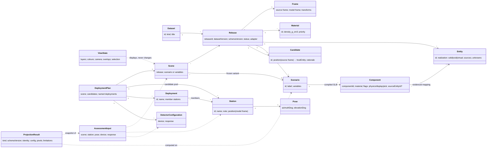
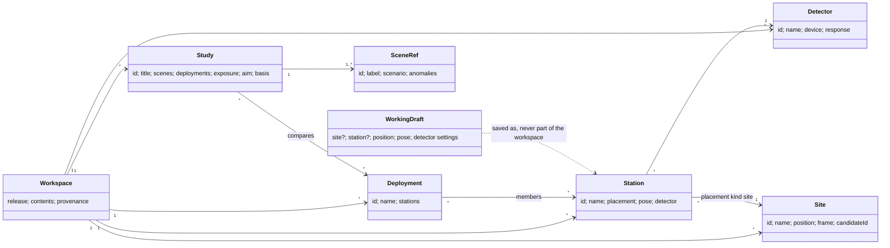

# Domain model

The living record of the platform's domain model: bounded contexts, entities and value objects, identities, relationships, invariants and lifecycles, and how the code currently realises them. It is updated in the same commit as any change that adds, removes or changes a domain concept (FR-Q10), and every model change is logged at the end.

How this relates to other documents:

- [`CONTEXT.md`](../../CONTEXT.md) is the short required-reading entry: product context and the **glossary** (ubiquitous language). Terms are defined there; this file models how they relate and what must always hold.
- Decisions that shape the model are ADRs in [ARCHITECTURE_DECISIONS](../ARCHITECTURE_DECISIONS.md) (notably ADR-008, ADR-016, ADR-017, ADR-020, ADR-021); requirements that change it are in [FEATURE_REQUIREMENTS](../FEATURE_REQUIREMENTS.md).
- Module ownership is in [MODULE_BOUNDARIES](MODULE_BOUNDARIES.md); formulas in [CALCULATION_MODEL](CALCULATION_MODEL.md); data contracts in [PROJECTION_DATA](PROJECTION_DATA.md) and the dataset schemas.

Each element below is marked **Current** (exists in code), **Partial** (exists implicitly or incompletely) or **Target** (decided, not built).

Last updated: 2026-10-16

## 1. Bounded contexts

| Context | Responsibility | Main concepts | Code today |
|---|---|---|---|
| Dataset & geometry | What the subject is: identity, frames, materials, volumes, scenarios, compiled geometry | Dataset, Release, Kind, Scenario, Material, Entity, Component, Frame | `dataset-loader`, `dataset-validation`, `dam-spec-v07`, `coordinates`, `compiled-glb`, `triangle-bvh`, `compiled-mesh-runtime`; `geometry-v07-qualification` (qualification only) |
| Detector | What measures: device geometry and response, independent of any dataset | DetectorConfiguration (Device, Response) | `detector-defaults`, `device-configuration`, `detector-pose` |
| Deployment planning | Where and how detectors are placed | Station, Pose, Candidate, DeploymentPlan, Selection | `deployment-state`, `compiled-deployment-adapter` (Partial: no plan aggregate yet) |
| Assessment | What a deployment would see: rays, columns, counts | AssessmentInput (snapshot), Session, Trace, ProjectionResult | `compiled-main-assessment`, `compiled-assessment`, `detector-projection`, `muon-response`, `assessment-controller` |
| Interpretation | Derived numerical layers and comparisons on results | PatternField, Overlay, Comparison, Export | `projection-pattern-*`, `contribution-*`, `pattern-comparison*`, `finite-model-references` |
| Anomaly & sensitivity | What problem the deployment must detect, and how well it would | AnomalyHypothesis, Region, DensityModel, HostConstraint, ParameterSweep, SensitivityResult | Target (ADR-025, FR-H); legacy counterfactual significance is a dam-specific precursor |
| Scan | Many assessments over a constrained space | ScanDefinition, ScanResult, Ranking | Target (FR-S1…S5) |
| Reconstruction | 3D picture recoverable from several projections | VoxelGrid, SimulatedMeasurement, Reconstruction, QualityMetrics | Target (ADR-021, FR-M6…M9) |
| Presentation | How results are shown; never a source of truth | Scene views, canvases, demonstration mode | `*-scene-view`, `projection-canvas-view`, `main-page` |

Contexts depend downward only: Presentation → Interpretation/Assessment → Planning → Detector and Dataset & geometry. Dataset & geometry and Detector never depend on each other.

## 2. Core model

### 2.1 Dataset & geometry

| Concept | Kind | Identity | Notes | Status |
|---|---|---|---|---|
| Dataset | Entity | `dataset_id` (e.g. `zhouning-lower-reservoir-dam`) | Describes one imaging subject; has a `kind` | Partial: `kind` is not yet in the registry or specs (FR-K2) |
| Kind | Value | `dam`, later `blast-furnace`, `tunnel`, … | Selects kind-specific compilers/adapters only; never branched on by generic code (ADR-016) | Target |
| Release | Entity, immutable | Full release ID `<dataset>@<dataVersion>[+schema<schemaVersion>]` | Registry entry with base URL, adapter, files, `integrity` hashes, `status` (`qualification`, …); one data version may have several releases in different formats | Current |
| Frame | Value | Per release | Source frame (e.g. `doc_frame`), `model_frame`, elevation datum, affine transforms for points and directions | Current |
| Material | Value | Material ID, per release | Density in g/cm³; precedence order in `classification.material_precedence`; air has zero column | Current |
| Entity | Entity | Canonical entity ID | Solid, void or virtual; virtual never enters physics; carries sources, confidence, unknowns | Current (v0.7 IR) |
| Water body / environment volume | Entity | ID | Kind-specific environment volumes (water for dams; burden, overburden for other kinds) | Current for dams |
| Scenario | Entity | Scenario ID within a release (`low`, `mid`, …) | A frozen environment variant: complete variable values plus its compiled geometry. Not the subject | Current |
| Component | Entity | Component ID within a scenario | Closed mesh with one material and flags; maps to a source entity only with evidence, otherwise "aggregate" | Current |
| SubjectFeature | Value (catalogue entry per release) | Source entity or water body ID | Named part of the subject with label, semantic class, group, colour and kind (`direct`: own component; `aggregate`: inside a merged component, unavailable until FR-GE4). One catalogue serves the 3D feature layer, projection outlines, picking, coverage tinting and ROI metrics; selections of features are view state (ADR-029) | Current: catalogue built by `feature-catalogue.js` at load (`dataset.features`); consumers pending (ADR-029, #15b) |
| RecognitionItem | Value (per release, from the display profile) | Item ID within the profile | One feature, several direct features (by members or semantic selection) or a material, with label, colour and default; only direct features may be members; presentation only, never in result identity | Current: `display-profile.js` → `dataset.recognitionItems`; derived defaults without a profile |
| Candidate | Value | Candidate ID | Dataset-supplied suggested station position in the source frame, with host entity and rationale; not a recommendation of pose | Current |
| Site conditions, detector models | Value | Per release | Sidecars; detector model sidecar is not used as calibration | Current (unused for physics) |

### 2.1a Scene and view state

| Concept | Kind | Identity | Notes | Status |
|---|---|---|---|---|
| Scene | Value | Release ID + scenario ID or environment variable values | The physical world of a calculation: geometry and materials follow from the release and environment state only. Composition: scene = release + environment state | Partial: the code passes release and `environment` separately rather than as one scene value |
| ViewState | Value, per view | — | Layer visibility, colours, transparency, camera, overlays, selection. Owned by the views and `main-page`; never part of a scene, snapshot key or result. Saved camera views of the demonstration mode (model frame, per release in browser storage) are view state too, never part of a plan | Current |

### 2.1c Evaluation aims (Target, ADR-031)

| Concept | Kind | Notes |
|---|---|---|
| EvaluationAim | Value within a plan or study | What the user wants a deployment to achieve: terms of (region, metric, aggregation, parameters), combined by weights or constraints. User input; the app never assumes one. Evaluated for any station set and used unchanged as a scan objective |
| EvaluationRegion | Value | A recognition item, optionally limited by model-frame bounds; later an anomaly-hypothesis region. Evaluated at target points inside it from the calculation geometry |
| Metric (per point) | Derived value of a station set at a point | From cached results: in a field of view, counts and error of the cell holding the line at the stated resolution, usable views, angular spread, counts per steradian, covering and uniquely covering stations |
| AimTemplate | Value shipped with the app | Pre-filled aim (multi-view overlap of a target, extent of a region); editable; never applied unless chosen |

### 2.1b Anomaly hypotheses (Target, ADR-025)

| Concept | Kind | Notes |
|---|---|---|
| AnomalyHypothesis | Entity within a plan or study | Parameterised change of the physical state: region + density model + host constraint + parameters (size, position, density, development step). Not part of a dataset release; datasets may ship templates |
| Region | Value | Analytic primitive or closed mesh in the model frame; kind generators (furnace cohesive zone, hearth wall profile, seepage surface) produce regions |
| DensityModel | Value | Void, relative change, absolute density, material replacement, fluid saturation |
| HostConstraint | Value | Materials/entities the change may act on; applied after material precedence |
| ParameterSweep | Value | Ranges and steps over anomaly parameters (and development steps over time) |
| SensitivityResult | Value, versioned | Baseline and perturbed counts, ΔN, significance (stat/sys), exposure to threshold, footprint; labelled simulated hypothesis |

Scene composition (Target): **scene = release + environment state + active anomaly hypotheses**. A baseline scene has none; sensitivity compares a scene with and without an anomaly using the same snapshot and stored traces.

### 2.2 Detector

| Concept | Kind | Notes | Status |
|---|---|---|---|
| DetectorConfiguration | Value | Device (layers, strip pitch/count, size, spacing; derived baseline, slope step, max slopes, FOV) + Response (layer efficiency, live fraction, angular resolution, systematic fraction, exposure, angular flux model) | Current, single configuration per app |
| Device model / calibration | Value | Named instrument with calibrated parameters | Target (FR-X3) |

### 2.3 Deployment planning

| Concept | Kind | Notes | Status |
|---|---|---|---|
| Station (candidate) | Entity within a plan | One entry of the study's candidate pool: unique ID within the plan, name, note, position in the model frame, one pose, detector reference, optional `candidateId` (the dataset candidate it started from). Several poses at one site are several stations. Fixed once saved: changed only by an explicit update (FR-P6) | Current (plan format; fixed in the app since 14b) |
| Working station | Session state | The station being tuned in detail (position, pose, detector settings, source candidate); becomes a candidate only when saved; never part of the plan. Can be placed by clicking the model: inside a clicked cavity (feature category `void`) on its floor plus 1 m, found with the calculation geometry, or 0.5 m off another surface | Current (`study-state.js`, 14b) |
| Deployment | Entity within a plan | Named subset of the candidate pool (unique ID within the plan, name, member station IDs); a station can be in several | Current (plan 1.1.0, UI 14c) |
| Pose | Value | Azimuth from model `X+` towards `Y+`, elevation above horizontal; detector-local basis follows | Current |
| DeploymentPlan (study) | Aggregate root | One observation task on one release: scene (release reference + content hash for user-loaded datasets, scenario), named detector configurations (`default` required), candidate pool (stations), named deployments, reserved anomalies, schema version; `muography-plan` 1.1.0 ([PLAN_FORMAT](PLAN_FORMAT.md)). Session state (working station, active candidate, active deployment) is stored next to it, never inside | Current: plan 1.1.0, several studies per release (switch, new; import creates a study) |
| Selection | Value | The active deployment (session state); the overview shows it | Current as session state (14c); overview Target (FR-M4, #15) |

### 2.3a Workspace model (Target, ADR-033)

Proposed replacement for §2.3, specified in [WORKSPACE_FORMAT](WORKSPACE_FORMAT.md) (`muography-workspace` 2.0). Not implemented; §2.3 remains the current model until the storage switch-over.

| Concept | Kind | Identity | Notes |
|---|---|---|---|
| Workspace | Aggregate root, one per release | Release ID (+ content hash); `ws-…` ID for provenance | Flat store of everything saved for a release; the same format is a full export or, with `contents: selection` and `roots`, the export of a selection with its closure. Session and view state are stored next to it, never inside |
| Site | Entity | Global ID `site-…` | Where a detector can stand: a point in a named frame (`model_frame` in 2.0), optional dataset candidate. Created implicitly when a draft is saved at a new position; never matched by position |
| Station | Entity | Global ID `sta-…` | Site + pose + detector: one saved way of observing (UI 我的点位). `placement` is a tagged value (`site` in 2.0) so carrier mounts can be added as a kind. No exposure: the same station may be observed for different durations in different studies |
| Detector | Entity | Global ID `det-…`; equal content is treated as the same detector on import | Device and response without exposure |
| Deployment | Entity | Global ID `dep-…` | Ordered set of stations evaluated together; shared by any number of studies |
| Study | Entity, opt-in | Global ID `study-…` | One question: scenes (release scenarios now, anomaly hypotheses later), the deployments it compares, its exposure (tagged: `constant` days in 2.0, an observation schedule later), an aim (ADR-031, reserved) and an optional basis (item hashes recorded with a conclusion) |
| Item hash | Value | `sha256:` of the item's canonical text without its ID | Same ID + same hash: same item; same ID + different hash: conflict on import |
| Working draft | Session state | — | Today's working station, remembering the site and station it came from |
| Playground exposure | Session state | — | The exposure used while no study is active (default 30 days); set on its own, not in the device dialog |
| Import | Process | — | Classify (new / identical / conflict) → preview → apply atomically; conflicts keep both by default |

Invariants (Target): (a) every reference resolves inside the document and a selection file holds exactly the closure of its roots; (b) items are never merged by position, only by explicit user action; (c) an import never writes before the user confirms and applies completely or not at all; (d) deleting an item with dependants lists them and never cascades silently; (e) exposure belongs to the study (or the playground session), never to a detector or station, so a detector means the same device everywhere (consistent with invariant 5).

### 2.4 Assessment and results

| Concept | Kind | Notes | Status |
|---|---|---|---|
| AssessmentInput | Value, immutable snapshot | Scene (release + environment) + station + pose + device + response, copied at calculation start. Composition: assessment = scene + detector configuration + station + pose | Current (scene implicit) |
| Session | Process | Binds one geometry context; produces preview (25²) then final (65²) from the same snapshot; cancellable | Current |
| Trace | Value | Per ray: material totals, `materialColumns`, `mwe`, segments, entity lengths | Current |
| ProjectionResult | Value, versioned | `kind` ∈ {`compiled-detector-assessment`, `material-column-projection`} (`legacy-detector-assessment` is accepted only for replaying old exports), `schemaVersion`, identity (release, backend, scenario, variables, asset hashes), config, device, response, `modelVersion`, `plan` (hash + station ID of the source plan, or null; provenance, not identity), pixels, limitations | Current |
| Per-candidate result cache | Keyed by the assessment key (all effective inputs; names, ids and plan reference excluded), session memory | Compact form per candidate (≈ 90 KB at 65² plus sparse per-item ray lengths, no path segments yet); recomputed in the background when a study is opened; shared by the list, comparison, coverage view and overview (FR-P10) | Current (`candidate-results.js`, 14b) |
| Coverage (view) | Derived view of a station | Geometric coverage = device acceptance × pose (no physics): points whose detector line lies inside the acceptance, in front or behind, above the detector; physical coverage = expected counts per steradian from a result. A view of results, never an input; the physical map belongs to one result and is cleared when inputs change | Current for a single station and, geometric only, for up to 8 other candidates (`coverage-map.js`, 14d); multi-station physical Target (ADR-026, #15) |
| Usable view | Derived value of a station at a point | The station sees the point (geometric coverage) and the projection pixel holding its line through the point has N ≥ 100 counts (≤ 10 % counting error; option N ≥ 400). Multi-view coverage counts usable views and measures their angular spread (FR-M15). A station is never a usable view of points in the feature it sits in | Current on subject surfaces (`coverage-map.js`, 15d), on a slice plane through the interior and on shown target features (15e) |
| PlanRun | Value, versioned | Output of the headless runner: one ProjectionResult per chosen station plus a summary (`muography-plan-run` 1.0.0: plan hash, release, scenario, quality, model version, per-station file digest and totals); no clock data, identical for any thread count ([PLAN_FORMAT](PLAN_FORMAT.md#batch-runs)) | Current |
| Exports | Value, versioned | `muography-plan` 1.1.0 (round trip; reads 1.0), `muography-plan-run` 1.0.0 (batch runs), contour export 1.0.0, `projection-pattern-layers` 1.0.0, `projection-pattern-comparison`; the export-only `compiled-deployment-snapshot` 0.1.0 is retired | Current |

## 3. Identities

- **Release ID** is the only key for data references: caches, stored plans, plan files and results use the full string, never the dataset ID alone.
- **Plan hash**: `sha256:` of a plan's canonical text ([PLAN_FORMAT](PLAN_FORMAT.md)); identical plans have identical hashes. Station IDs are unique within a plan.
- **Snapshot key**: a deterministic, sorted-key JSON of all effective inputs (`createPatternSnapshot`); identical inputs give identical keys. Not a hash or signature.
- **Asset identity**: SHA-256 of the source spec and scenario GLB from the verified manifest; synthetic buffers are labelled `unverified-buffer`.
- **User-loaded datasets** (Target, ADR-019): release ID plus content hash; a plan refuses to run against a different file.

## 4. Invariants

These must always hold; code and tests enforce them where noted. Each invariant needs at least one test that fails if it is broken (FR-Q11, [TEST_STRATEGY](TEST_STRATEGY.md)).

1. A point and a direction are different types: translation applies to points only. (`coordinates.js`, tests)
2. Material = positive volumes − negative volumes, resolved by the declared material precedence; virtual geometry and markers never enter physics. (`compiled-mesh-runtime.js`)
3. Display, classification and ray intersection express the same geometry. View state is never part of a scene, snapshot or result: hiding a material region, internal feature or environment volume never removes it from physics. (Module boundaries in `tests/integration/main-architecture.test.mjs`; overlay independence per PROJECTION_VALIDATION §1; a direct layer-toggle test is a gap, §6)
4. A frozen scenario's geometry is never interpolated to represent another environment.
5. A device configuration means the same thing for every dataset; datasets never supply uncalibrated device parameters implicitly.
6. A result always carries the identity of everything it was computed from (release, backend, scenario/variables, model version, device, response, sampling, ray length) and its limitations. (FR-C5; legacy ray length recorded since FR-C2)
7. A stale result is never published over a newer input. (`assessment-controller.js`, tests)
8. Results are history-independent: the same input gives the same output. (`muon-response.js` has no cache since `quick-response@2.0.0`; `tests/unit/muon-response.test.mjs`)
9. Generic code never branches on a dataset's kind or name. (FR-K1; existing leaks being removed)
10. Aggregate components never acquire source-entity ownership by name or proximity.
11. Unknown or approximate dimensions stay explicit metadata; they are never replaced by unexplained constants.
12. (Target) An active anomaly is part of the physical scene whether or not the view shows it; it never modifies the dataset release.
13. (Target) An anomaly changes only its declared host materials inside its region, after material precedence.
14. (Target) Baseline and perturbed results of a sensitivity evaluation come from the same snapshot and traces; the anomaly definition is part of the snapshot identity.
15. A projection pixel is a line through the detector; its ray, column and counts are those of the line's sky end, and the pixel records whether that end is in front of or behind the detector (`side`). Since `quick-response@4.0.0` the projection core rejects a ray below the horizon. (`detector-pose.js` `skySideDirection`, `detector-projection.js`, tests)
16. A deployment lists only stations of its own plan, each once; removing a station removes it from every deployment. A plan never holds session or view state (working station, active candidate, layers).
17. A saved candidate changes only by an explicit update; its cached result is valid exactly while its snapshot key is unchanged.

## 5. Lifecycles

- **Release**: imported byte for byte → validated (schemas, hashes, conformance) → registered with a `status` → may become the registry default (current default: `zhouning-lower-reservoir-dam@0.6.2+schema0.7.0`). Releases are immutable; changes produce a new release.
- **Assessment**: input change → debounce → snapshot → session → preview (25²) → final (65²) → published; any newer input cancels and invalidates the old generation.
- **Study** (FR-P5): created for a release (fresh, or imported) → candidates sketched and tuned (working station → saved candidates) → named deployments composed and evaluated from per-candidate cached results → one or several deployments exported; schema-versioned with migrations.
- **Workspace** (Target, ADR-033): created empty for a release (or migrated once from 1.x studies) → draft explored and saved as stations (sites implicit) → stations grouped into deployments → optional studies compose deployments, scenes and an aim; a recorded conclusion stores the basis → any selection exported as a self-contained file → merged into another workspace of the same release through the import preview.
- **Reconstruction** (Target): plan → simulated measurements → column estimates → voxel reconstruction → quality metrics; always labelled simulated.

## 6. Gaps between the current code and this model

| Gap | Model element | Tracked as |
|---|---|---|
| No `kind` in registry/specs; dam terms in generic modules | Dataset.kind | FR-K1, FR-K2, FR-K3 |
| Only frozen scenario variables; no continuous environment variables (the retired legacy backend had a continuous upstream level) | Scenario, environment | FR-K2, FR-E1, MT-1 |
| Stations stored per release are invisible under another release (e.g. the retired legacy releases) | DeploymentPlan | FR-B2 |
| One rock-like energy loss for all materials | Material | FR-K4 |
| Generic modules name material IDs (`air`, `concrete`, `rock`, `steel`) instead of dataset-declared material roles | Material | FR-K11 |
| Scene is not one value in code (release and environment passed separately) | Scene | FR-P1 (plan schema) |
| Stations bundle position, pose and detector inside one study; exposure sits in the detector response; studies cannot share stations or deployments; the 比较 set duplicates deployments | Workspace model §2.3a | ADR-033 |
| No direct test that toggling every display layer leaves the projection result and snapshot key unchanged | Invariant 3 | FR-Q11 |

## 7. Open modelling questions

- How are continuous environment variables (e.g. water level, burden level) modelled per kind: declared ranges with kind-specific resolvers, or only frozen scenarios?
- What are the identity and versioning of a ScanDefinition and a Reconstruction run?

## 7. Kind variation register

What may differ between subject kinds, so that generic code is not shaped by the single dam we have (ADR-016, limits of current evidence). **Observed** means seen in a real dataset in this repository; everything else is an **assumption** to verify with real data before it shapes code.

| Axis | Dam: Zhouning RCC dam (observed) | Other dam types (assumed: arch, earth/rockfill) | Blast furnace (assumed) | Tunnel / underground (assumed) | Generic abstraction today |
|---|---|---|---|---|---|
| Geometry definition | Parametric transverse sections (extrusions), boxes, swept galleries, chutes; one dam-specific schema; compiled to closed GLB meshes | Curved arches; zoned embankments with core/filters | Axisymmetric layered shells (steel shell, refractory lining, staves); burden and hearth inside | Long excavation under kilometre-scale terrain; overburden dominates | Compiled package only (ADR-017, provisional) |
| Materials | Concrete, water, rock, steel, air | Clay core, filters, rockfill; zoned densities | Steel, refractory, coke, ore, slag, hot metal; high-Z | Rock types, water-bearing zones | Material ID + density; one energy-loss law (FR-K4) |
| Environment variables | Upstream/tail water levels, gate states; frozen scenarios | Reservoir level; pore water / phreatic surface | Burden level, hearth level, campaign age; changes over time | Groundwater; mostly static | Scenario variables (frozen); continuous only on legacy (FR-E1) |
| Regions of interest | Discrete cavities and features: galleries, rooms, shaft, spillway, water body | Seepage zones, internal erosion, core integrity | Continuous zones: cohesive zone, deadman, refractory wear profile | Voids, fracture zones, density anomalies in overburden | Legacy dam targets; compiled semantic targets by canonical ID only (FR-M3) |
| Detector placement | Outside the dam and in galleries; mostly looking up and across | Downstream toe, galleries | Around the furnace near ground level; near-horizontal views | Inside the tunnel looking up | Station + pose; upward rays only (FR-K6) |
| Display and interaction | External 3D view, internal proxies, water layers, slope-space projections | Cross-sections through zones | Cut-away / sectional views of a closed vessel; time slider | Underground viewpoint; terrain above | Dam layer list hard-coded in backends (FR-K3) |
| Typical anomalies (owner-stated needs) | Voids, loosened or densified zones without clear structural features; seepage zone development | Seepage, internal erosion, core defects | Cohesive-zone shape; hearth wall thickness (erosion) | Voids, fracture zones, water-bearing zones | None yet; ADR-025 proposes generic regions + kind generators |
| Main physics prerequisites | Open sky, rock-like matter, moderate columns | Similar to the dam | High-Z energy loss (FR-K4); small subject, short rays | Deep overburden, large columns (FR-K5) | Rock-like energy loss; `10⁵ GeV` cap |

Add a column (and a kind profile, FR-K10) when a new kind or dam type is considered; move a cell from assumed to observed only with a real dataset.

## Change log

- 2026-10-17: §2.3a: exposure moved from the station to the study (playground exposure as session state), owner decision.
- 2026-10-16: Added §2.3a workspace model (Target, ADR-033): Workspace, Site, Station (site + pose + detector + exposure), Detector, Deployment, Study (scenes, aim, basis), item hash, import; gap row; workspace lifecycle.
- 2026-10-14: Coverage (view) current for a single station; back-side lines included.
- 2026-10-14: ProjectionResult records its source plan (hash + station ID).
- 2026-10-14: DeploymentPlan and Station current (`muography-plan` 1.0.0); plan hash identity; two open questions answered (per-plan named detector configurations; plans own stations with a candidate reference).
- 2026-10-14: Invariant 15: pixels are lines evaluated at their sky end (FR-C7).
- 2026-10-13: Added RecognitionItem (display profile).
- 2026-10-13: SubjectFeature catalogue implemented (`feature-catalogue.js`); virtual entities excluded.
- 2026-10-13: Added SubjectFeature (proposed catalogue, ADR-029).
- 2026-10-12: Legacy backend retired (ADR-028): module lists, ProjectionResult kinds, exports and environment gap updated.
- 2026-10-12: Legacy ray length recorded (FR-C2); gap row removed.
- 2026-10-12: Invariant 8 now holds and is tested (FR-C1); gap row removed.
- 2026-10-12: Added Coverage as a derived view (ADR-026).
- 2026-10-12: Renamed "deficiency" to "anomaly" (AnomalyHypothesis).
- 2026-10-12: Added anomaly hypotheses (Target, ADR-025): context, concepts, scene composition, invariants 12–14, register row.
- 2026-10-12: Added §7 kind variation register (observed Zhouning RCC dam vs assumed other kinds).
- 2026-10-12: Clarified Scene vs ViewState: display options belong to the view state, never the scene; scene = release + environment state; assessment = scene + detector + station + pose; plan = scene + stations. Invariant 3 restated; two gaps added.
- 2026-10-10: Initial model from the current code and decisions ADR-008…021.
