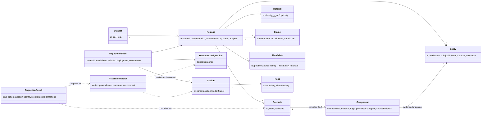

# Domain model

The living record of the platform's domain model: bounded contexts, entities and value objects, identities, relationships, invariants and lifecycles, and how the code currently realises them. It is updated in the same commit as any change that adds, removes or changes a domain concept (FR-Q10), and every model change is logged at the end.

How this relates to other documents:

- [`CONTEXT.md`](../../CONTEXT.md) is the short required-reading entry: product context and the **glossary** (ubiquitous language). Terms are defined there; this file models how they relate and what must always hold.
- Decisions that shape the model are ADRs in [ARCHITECTURE_DECISIONS](../ARCHITECTURE_DECISIONS.md) (notably ADR-008, ADR-016, ADR-017, ADR-020, ADR-021); requirements that change it are in [FEATURE_REQUIREMENTS](../FEATURE_REQUIREMENTS.md).
- Module ownership is in [MODULE_BOUNDARIES](MODULE_BOUNDARIES.md); formulas in [CALCULATION_MODEL](CALCULATION_MODEL.md); data contracts in [PROJECTION_DATA](PROJECTION_DATA.md) and the dataset schemas.

Each element below is marked **Current** (exists in code), **Partial** (exists implicitly or incompletely) or **Target** (decided, not built).

Last updated: 2026-10-10

## 1. Bounded contexts

| Context | Responsibility | Main concepts | Code today |
|---|---|---|---|
| Dataset & geometry | What the subject is: identity, frames, materials, volumes, scenarios, compiled geometry | Dataset, Release, Kind, Scenario, Material, Entity, Component, Frame | `dataset-loader`, `dataset-validation`, `dam-spec-v07`, `coordinates`, `compiled-glb`, `triangle-bvh`, `compiled-mesh-runtime`; legacy `geometry-kernel`, `legacy-geometry-adapter` |
| Detector | What measures: device geometry and response, independent of any dataset | DetectorConfiguration (Device, Response) | `detector-defaults`, `device-configuration`, `detector-pose` |
| Deployment planning | Where and how detectors are placed | Station, Pose, Candidate, DeploymentPlan, Selection | `deployment-state`, `*-deployment-adapter` (Partial: no plan aggregate yet) |
| Assessment | What a deployment would see: rays, columns, counts | AssessmentInput (snapshot), Session, Trace, ProjectionResult | `main-assessment`, `compiled-main-assessment`, `compiled-assessment`, `detector-projection`, `muon-response`, `assessment-controller` |
| Interpretation | Derived numerical layers and comparisons on results | PatternField, Overlay, Comparison, Export | `projection-pattern-*`, `contribution-*`, `pattern-comparison*`, `finite-model-references` |
| Scan | Many assessments over a constrained space | ScanDefinition, ScanResult, Ranking | Target (FR-S1…S5) |
| Reconstruction | 3D picture recoverable from several projections | VoxelGrid, SimulatedMeasurement, Reconstruction, QualityMetrics | Target (ADR-021, FR-M6…M9) |
| Presentation | How results are shown; never a source of truth | Scene views, canvases, demonstration mode | `*-scene-view`, `projection-canvas-view`, `main-page` |

Contexts depend downward only: Presentation → Interpretation/Assessment → Planning → Detector and Dataset & geometry. Dataset & geometry and Detector never depend on each other.

## 2. Core model

### 2.1 Dataset & geometry

| Concept | Kind | Identity | Notes | Status |
|---|---|---|---|---|
| Dataset | Entity | `dataset_id` (e.g. `zhouning-lower-reservoir-dam`) | Describes one imaging subject; has a `kind` | Partial: `kind` is not yet in the registry or specs (FR-K2) |
| Kind | Value | `dam`, later `blast-furnace`, `tunnel`, … | Selects kind-specific compilers/adapters only; never branched on by generic code (ADR-016) | Target |
| Release | Entity, immutable | Full release ID `<dataset>@<dataVersion>[+schema<schemaVersion>]` | Registry entry with base URL, adapter, files, `integrity` hashes, `status` (`qualification`, …); one data version may have several releases in different formats | Current |
| Frame | Value | Per release | Source frame (e.g. `doc_frame`), `model_frame`, elevation datum, affine transforms for points and directions | Current |
| Material | Value | Material ID, per release | Density in g/cm³; precedence order in `classification.material_precedence`; air has zero column | Current |
| Entity | Entity | Canonical entity ID | Solid, void or virtual; virtual never enters physics; carries sources, confidence, unknowns | Current (v0.7 IR) |
| Water body / environment volume | Entity | ID | Kind-specific environment volumes (water for dams; burden, overburden for other kinds) | Current for dams |
| Scenario | Entity | Scenario ID within a release (`low`, `mid`, …) | A frozen environment variant: complete variable values plus its compiled geometry. Not the subject | Current |
| Component | Entity | Component ID within a scenario | Closed mesh with one material and flags; maps to a source entity only with evidence, otherwise "aggregate" | Current |
| Candidate | Value | Candidate ID | Dataset-supplied suggested station position in the source frame, with host entity and rationale; not a recommendation of pose | Current |
| Site conditions, detector models | Value | Per release | Sidecars; detector model sidecar is not used as calibration | Current (unused for physics) |

### 2.2 Detector

| Concept | Kind | Notes | Status |
|---|---|---|---|
| DetectorConfiguration | Value | Device (layers, strip pitch/count, size, spacing; derived baseline, slope step, max slopes, FOV) + Response (layer efficiency, live fraction, angular resolution, systematic fraction, exposure, angular flux model) | Current, single configuration per app |
| Device model / calibration | Value | Named instrument with calibrated parameters | Target (FR-X3) |

### 2.3 Deployment planning

| Concept | Kind | Notes | Status |
|---|---|---|---|
| Station | Entity within a plan | Name and position in the model frame; currently also carries the pose (`az`, `el`) | Partial: station and pose not separated |
| Pose | Value | Azimuth from model `X+` towards `Y+`, elevation above horizontal; detector-local basis follows | Current |
| DeploymentPlan | Aggregate root | Release reference (+ content hash for user-loaded datasets), environment/scenario, candidate stations, **selected deployment** (subset with pose and device each), calculation settings, schema version | Target (FR-P1, ADR-020); today `deployment-state` holds candidates + one `active` index and is stored per release ID in `localStorage` |
| Selection | Value | Which stations are deployed; drives the multi-station overview | Target (FR-M4) |

### 2.4 Assessment and results

| Concept | Kind | Notes | Status |
|---|---|---|---|
| AssessmentInput | Value, immutable snapshot | Station, device, response, environment copied at calculation start | Current |
| Session | Process | Binds one geometry context; produces preview (25²) then final (65²) from the same snapshot; cancellable | Current |
| Trace | Value | Per ray: material totals, `materialColumns`, `mwe`, segments, entity lengths | Current |
| ProjectionResult | Value, versioned | `kind` ∈ {`compiled-detector-assessment`, `legacy-detector-assessment`, `material-column-projection`}, `schemaVersion`, identity (release, backend, scenario, variables, asset hashes), config, device, response, `modelVersion`, pixels, limitations | Current |
| Per-station result cache | Keyed by snapshot key | Lets the overview and detail modes share results | Target (ADR-020) |
| Exports | Value, versioned | `compiled-deployment-snapshot` 0.1.0, contour export 1.0.0, `projection-pattern-layers` 1.0.0, `projection-pattern-comparison`, legacy plan JSON | Current; not yet a round-trip plan format |

## 3. Identities

- **Release ID** is the only key for data references: caches, stored stations, plans and results use the full string, never the dataset ID alone.
- **Snapshot key**: a deterministic, sorted-key JSON of all effective inputs (`createPatternSnapshot`); identical inputs give identical keys. Not a hash or signature.
- **Asset identity**: SHA-256 of the source spec and scenario GLB from the verified manifest; synthetic buffers are labelled `unverified-buffer`.
- **User-loaded datasets** (Target, ADR-019): release ID plus content hash; a plan refuses to run against a different file.

## 4. Invariants

These must always hold; code and tests enforce them where noted.

1. A point and a direction are different types: translation applies to points only. (`coordinates.js`, tests)
2. Material = positive volumes − negative volumes, resolved by the declared material precedence; virtual geometry and markers never enter physics. (`compiled-mesh-runtime.js`)
3. Display, classification and ray intersection express the same geometry; display state never changes scientific results. (architecture tests)
4. A frozen scenario's geometry is never interpolated to represent another environment.
5. A device configuration means the same thing for every dataset; datasets never supply uncalibrated device parameters implicitly.
6. A result always carries the identity of everything it was computed from (release, backend, scenario/variables, model version, device, response, sampling, ray length) and its limitations. (FR-C5; legacy ray length still missing, FR-C2)
7. A stale result is never published over a newer input. (`assessment-controller.js`, tests)
8. Results are history-independent: the same input gives the same output. **Currently violated** by the flux cache (FR-C1).
9. Generic code never branches on a dataset's kind or name. (FR-K1; existing leaks being removed)
10. Aggregate components never acquire source-entity ownership by name or proximity.
11. Unknown or approximate dimensions stay explicit metadata; they are never replaced by unexplained constants.

## 5. Lifecycles

- **Release**: imported byte for byte → validated (schemas, hashes, conformance) → registered with a `status` → may become the registry default (current default: `zhouning-lower-reservoir-dam@0.6.2+schema0.7.0`). Releases are immutable; changes produce a new release.
- **Assessment**: input change → debounce → snapshot → session → preview (25²) → final (65²) → published; any newer input cancels and invalidates the old generation.
- **Deployment plan** (Target): draft → stations selected → evaluated (per-station cached results) → exported/shared; schema-versioned with migrations.
- **Reconstruction** (Target): plan → simulated measurements → column estimates → voxel reconstruction → quality metrics; always labelled simulated.

## 6. Gaps between the current code and this model

| Gap | Model element | Tracked as |
|---|---|---|
| No `kind` in registry/specs; dam terms in generic modules | Dataset.kind | FR-K1, FR-K2, FR-K3 |
| Legacy environment is `{upstream, downstream}`; compiled uses scenario variables | Scenario, environment | FR-K2, FR-E1 |
| Station carries pose; no plan aggregate; single active station | Station, Pose, DeploymentPlan | FR-P1, ADR-020 |
| Stations stored per release are invisible after the default changed | DeploymentPlan | FR-B2 |
| Flux cache makes results history-dependent | Invariant 8 | FR-C1 |
| Legacy results do not record the 500 m ray cutoff | Invariant 6 | FR-C2 |
| One rock-like energy loss for all materials | Material | FR-K4 |

## 7. Open modelling questions

- Does a DeploymentPlan carry one detector configuration or one per station? (Recommended: per station, defaulting to a plan-level configuration.)
- Is "candidate" (dataset-supplied) distinct from "station" (plan-owned) in the saved plan, or does a plan copy candidates into stations? (Recommended: plans own stations and keep a reference to the originating candidate ID.)
- How are continuous environment variables (e.g. water level, burden level) modelled per kind: declared ranges with kind-specific resolvers, or only frozen scenarios?
- What are the identity and versioning of a ScanDefinition and a Reconstruction run?

## Change log

- 2026-10-10: Initial model from the current code and decisions ADR-008…021.
